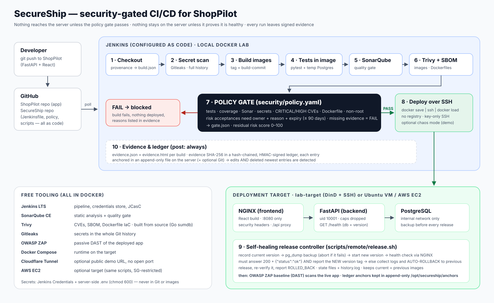

# SecureShip — Security-Gated DevSecOps Pipeline for ShopPilot

**Jenkins · Docker · SonarQube · Trivy · Gitleaks · OWASP ZAP · Linux · SSH · (AWS EC2 optional)**

SecureShip is a CI/CD pipeline that does more than deploy. It **decides whether a release is safe and healthy enough to run**, and it keeps evidence of every decision.

ShopPilot (FastAPI + React + PostgreSQL) is the application it ships. Every push goes through this chain:

> secret scan → build → tests *inside the image* → SonarQube → Trivy CVE + Dockerfile scan + SBOM → **policy gate** → SSH deploy → **health check with automatic rollback** → DAST → **signed evidence report**

Everything here runs **for free** on a laptop with Docker Desktop. The same scripts deploy to a real Ubuntu server or AWS EC2 when you want to.

## In plain words

Whenever ShopPilot's code changes, SecureShip automatically:

1. **Checks the code works**: ShopPilot's own 303 tests run inside the exact Docker image that will ship.
2. **Checks code quality**: SonarQube quality gate.
3. **Checks for leaked passwords and API keys**: Gitleaks scans the whole Git history.
4. **Scans the Docker images for vulnerabilities**: Trivy, plus a CycloneDX SBOM.
5. **Decides whether it is safe to deploy**: one policy file, fail-closed, with expiring exceptions.
6. **Deploys it** over SSH, but only if every required check passed.
7. **Restores the previous version automatically** if the new one doesn't prove it is healthy, *and* that it is the version answering.

Every run, including blocked and failed ones, leaves an evidence report and a tamper-evident ledger entry.

**First real run on Windows: follow [docs/START_HERE.md](docs/START_HERE.md).**

## Verification status

Be precise about what has been shown to work, and how:

| Area | Status | Evidence |
|---|---|---|
| Gate rules, exception expiry, risk score | ✅ unit-tested | `tests/test_gate.py` |
| Ledger chain, HMAC, external anchors (incl. deleting newest entries) | ✅ unit + integration-tested | `tests/test_ledger_and_report.py`, `tests/test_evidence_anchoring.py` (real Git anchor repo; SSH simulated) |
| Release controller: deploy, auto-rollback, failed rollback, aborted backup, stale version, pruning | ✅ tested against simulated `docker`/`curl` | `tests/test_release_flow.py` |
| ShopPilot `/health` endpoint | ✅ tested in ShopPilot's own suite (303 passed on PostgreSQL 16), plus live uvicorn checks with the DB up, down and up again | `backend/tests/test_health.py` in ShopPilot |
| ShopPilot frontend production build used by `Dockerfile.frontend` | ✅ `npm ci` + `npm run build` with `VITE_API_URL=/api` on Node 22 against ShopPilot's real code (Vite 8, 2,631 modules); the bundle calls `/api` | — |
| The real `scripts/remote/health-check.sh` against the **real** ShopPilot backend + built website + PostgreSQL, routed like NGINX (`/health`, `/api/*` with the prefix stripped, `/` = website) | ✅ correct version → PASS; old version still answering → FAIL ("serving version …, expected …"); signup/login through `/api` → 200, unauthenticated API → 401; database stopped → FAIL (503) | — |
| `ci/preflight.sh` (disk, RAM, ports, repos, `/health` pushed) | ✅ tested against good and bad repositories | — |
| ShopPilot test command used by the pipeline (`DATABASE_URL` + `TEST_DATABASE_URL`) | ✅ same settings run ShopPilot's full suite (without the OCR libraries) | — |
| Shell scripts, Dockerfiles, compose files | ✅ linted / validated | shellcheck, hadolint, `docker compose config` |
| **Docker image builds, Jenkins run, SonarQube, Trivy, Gitleaks, ZAP, real SSH deploy and rollback** | ⏳ **not yet run end to end** | the first real lab run (docs/SETUP.md) is the test |
| Scanner source build via Go checksum DB | ⏳ written, not yet built | first `ci/bootstrap.sh` run |

45 automated tests cover SecureShip's own logic. They are **not** evidence that the whole pipeline works; only a real Docker-based run is.



---

## What makes it different

| Feature | What it does | Why it matters |
|---|---|---|
| **Policy-as-code release gate** | One YAML policy (`security/policy.yaml`) combines tests, coverage, Sonar, secrets, CVEs, Dockerfile misconfigurations and image hardening into a single PASS/FAIL. | Security rules are versioned and reviewed like code, not hidden in tool flags. |
| **Fail-closed** | If a scanner crashed or produced no report, the check **fails**. | "No report" never silently means "no problems". |
| **Expiring risk acceptances** | Exceptions need an owner, a reason and an expiry date (90 days max). Expired ones stop working automatically. | Nothing gets ignored forever. This is real vulnerability-management governance. |
| **Self-healing deployment** | Records the running version, backs up the database (and aborts if the backup fails), deploys, then checks health. The release must report the **new version tag**. Otherwise the previous release is restored automatically and verified. | Reliability engineering, not just deployment. |
| **Chaos mode** | A build parameter ships a deliberately broken backend (`crash` / `unhealthy`). | The rollback can be proven live, on demand, without changing ShopPilot. |
| **Tamper-evident ledger** | Each run's evidence is SHA-256 hashed into a hash-chained, HMAC-signed ledger. Every entry is also **anchored outside Jenkins**: in an append-only file on the deployment server (`chattr +a`), and optionally in a Git repo with force-push disabled. | Edited, re-ordered or deleted entries are detected, **including the newest ones**, which a hash chain alone cannot catch. It is *tamper-evident, not tamper-proof*: an attacker who controls Jenkins **and** every anchor store could still rewrite history. ([details](docs/SECURITY_POLICY.md#deployment-ledger)) |
| **Evidence report** | `evidence.html` and `evidence.json` per build: commit, build no., tests, Sonar, CVE counts, image tag, gate decision, deploy/health/rollback status, DAST, ledger hash. | Audit trail, and something concrete to show in an interview. ([sample](docs/sample/evidence-sample.html)) |
| **Authenticated scanner supply chain** | Trivy and Gitleaks are pinned to reviewed versions and **built from source**, with every module checked against Go's checksum database (a public, append-only transparency log). Docker's apt key is pinned by fingerprint. Each build records the scanners' provenance, and images get OCI labels plus a CycloneDX SBOM. | A checksum file downloaded from the same release as the binary proves nothing if the release itself is compromised, as happened with Trivy v0.69.4 in March 2026. ([details](docs/SUPPLY_CHAIN.md)) |
| **Shift-left + shift-right** | Static checks before deploy; an OWASP ZAP baseline scan against the live app after deploy. | Covers code, dependencies, configuration *and* runtime behaviour. |

---

## Pipeline stages

| # | Stage | Tool | Output (`reports/`) |
|---|---|---|---|
| 1 | Checkout + provenance | Git | `build.json` |
| 2 | Secret scan (full history) | Gitleaks | `gitleaks.json` |
| 3 | Build versioned images (`<build>-<commit>`) | Docker (multi-stage, non-root) | `image-meta.json` |
| 4 | Unit + API tests inside the built image, against a temporary PostgreSQL | pytest | `tests/junit.xml`, `tests/coverage.xml` |
| 5 | Static analysis + quality gate | SonarQube CE | `sonar.json` |
| 6 | Image CVEs, Dockerfile misconfigurations, SBOM | Trivy | `trivy-*.json`, `trivy-config.json`, `sbom-*.cdx.json` |
| 7 | **Policy gate** | `secureship gate` | `gate.json` |
| 8 | Deploy over SSH (no registry: `docker save \| ssh \| docker load`) | SSH, Docker Compose | `deploy.log` |
| 9 | Health check → keep, or auto-rollback | `release.sh`, `health-check.sh` | `deploy.json` |
| 10 | DAST of the live app | OWASP ZAP baseline | `dast/zap.html` |
| 11 | Evidence + ledger (runs on every build, even failed ones) | `secureship report` | `evidence.html`, `evidence.json` |

---

## Quick start (free local lab)

Requirements:
- Docker Desktop with 8 GB RAM minimum (16 GB recommended)
- **~25 GB free disk space**
- Git, and Git Bash or WSL on Windows

```bash
# 1. Push this repo to your GitHub as SecureShip-DevSecOps-Pipeline
# 2. Commit ShopPilot's /health endpoint (already added: backend/app/routers/health.py)
# 3. Check disk, RAM, ports, repos and /health, then start the lab: Jenkins, SonarQube, Linux target
./ci/preflight.sh
./ci/bootstrap.sh
```

`bootstrap.sh` does the setup for you:
- generates all passwords and a deploy SSH key
- creates the SonarQube token
- configures Jenkins as code and creates the `SecureShip` job

When it finishes:

| Service | URL |
|---|---|
| Jenkins | http://localhost:8080 (credentials printed by the script) |
| SonarQube | http://localhost:9000 |
| ShopPilot (deployed) | http://localhost:8088 |

Open Jenkins → **SecureShip** → **Build Now**. The first run registers the parameters.

Full guide and troubleshooting: [docs/SETUP.md](docs/SETUP.md)

## Demo scenarios (do these, screenshot them)

| Scenario | Expected result |
|---|---|
| Clean release | Gate PASS → DEPLOYED → healthy |
| Vulnerable dependency (`Jinja2==2.10`) | Gate **FAIL**, nothing deployed |
| Failing test | Gate **FAIL** |
| Hard-coded token committed | Gate **FAIL** (Gitleaks) |
| `CHAOS_MODE=crash` | Health check fails → **ROLLED_BACK** to the previous version |
| Edit a ledger line, or delete the newest entries | Ledger verification against the anchors → **FAILED**, naming the affected entries |
| Risk acceptance with a past expiry | Finding blocks again |

Step-by-step instructions: [docs/DEMO_SCENARIOS.md](docs/DEMO_SCENARIOS.md)

## Repository layout

```
Jenkinsfile                 declarative pipeline (stages above)
docker/                     hardened Dockerfiles, NGINX template, runtime docker-compose.yml
scripts/                    build, test, sonar, scan, gate, deploy, health-check, rollback, dast, evidence, verify-ledger
scripts/remote/             release controller + health check that run ON the target
secureship/                 Python engine: policy gate, ledger + external anchors, evidence report (stdlib + PyYAML)
security/policy.yaml        the release policy (policy-as-code)
security/exceptions.yaml    risk acceptances with owner/reason/expiry
ci/                         free lab: Jenkins (JCasC), SonarQube, DinD+SSH target, preflight.sh, bootstrap.sh
target/setup-target.sh      turn a fresh Ubuntu VM / EC2 instance into a deployment target
integration/                generic /health endpoint for other FastAPI apps (ShopPilot already has its own)
tests/                      45 tests: gate rules, ledger + anchors, evidence, release/rollback flow
docs/                       setup, integration, policy, demos, AWS, interview notes, sample report
architecture/               architecture.svg / architecture.png
```

## Testing the pipeline itself

```bash
pip install pytest pyyaml
python -m pytest -q tests      # 45 tests, ~12 s (needs git and jq)
```

These test SecureShip's own logic, not the full pipeline. `tests/test_release_flow.py` runs the real `release.sh` against fake `docker`/`curl` commands. It covers:
- a successful deploy
- automatic rollback
- a failed first deploy
- a failed rollback
- an aborted database backup
- a "healthy but old version" release
- manual rollback
- image pruning

## Security design decisions

- **Secrets** live only in Jenkins Credentials and in a `chmod 600` `.env` file on the server. `.dockerignore` keeps `.env` and `.git` out of images.
- **Images** run as non-root (UID 10001 / 101) with `cap_drop: ALL` and `no-new-privileges`. They use slim bases with OS packages upgraded at build time. PyTorch is installed CPU-only, which removes GBs of CUDA libraries and their CVEs.
- **Network:** PostgreSQL sits on an `internal` Docker network and is never published. Only NGINX listens publicly. The backend is reachable only through `/api`.
- **SSH:** key-only, no root login, dedicated `deploy` user, host-key pinning on first use. Every value passed to remote commands is validated against a strict pattern.
- **Data safety:** `pg_dump` runs before every release; the deploy aborts if it fails. The database container is never recreated by a release.
- **Jenkins:** configured as code, with no setup wizard and no anonymous access. The controller drops root after granting itself Docker-socket access. The lab trade-offs (Docker socket, privileged DinD target) are documented in [docs/SETUP.md](docs/SETUP.md).

## Optional: AWS EC2

The deploy scripts don't care whether the target is the lab container, a VM or EC2. **EC2 can cost money** (free-tier limits, public IPv4 charges), so read [docs/AWS_EC2.md](docs/AWS_EC2.md) and set a billing alert before launching anything.

## Resume entry

See [docs/RESUME.md](docs/RESUME.md). It has one version for the free local lab and one to use only after you have actually deployed to EC2.
